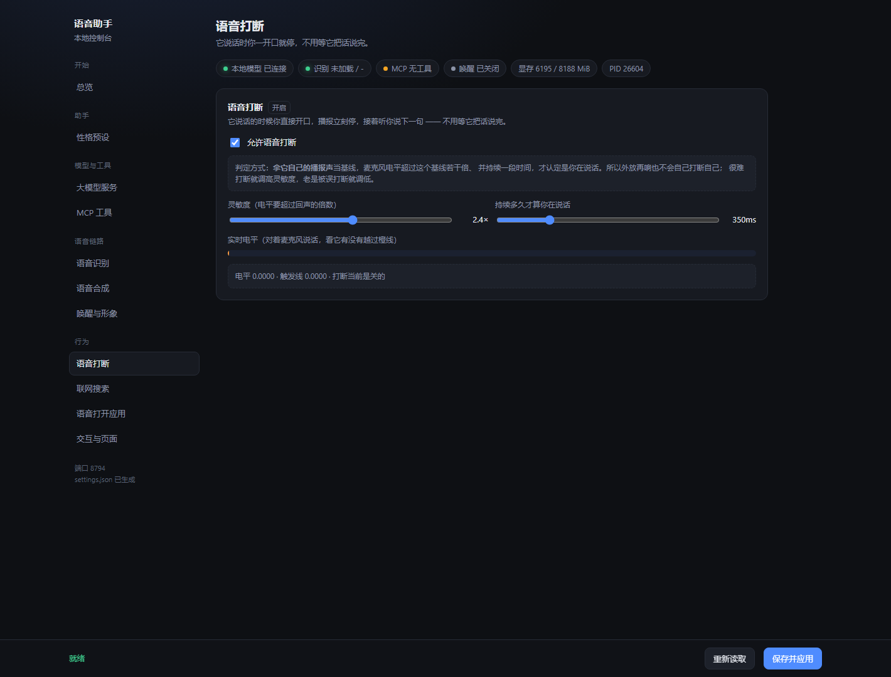
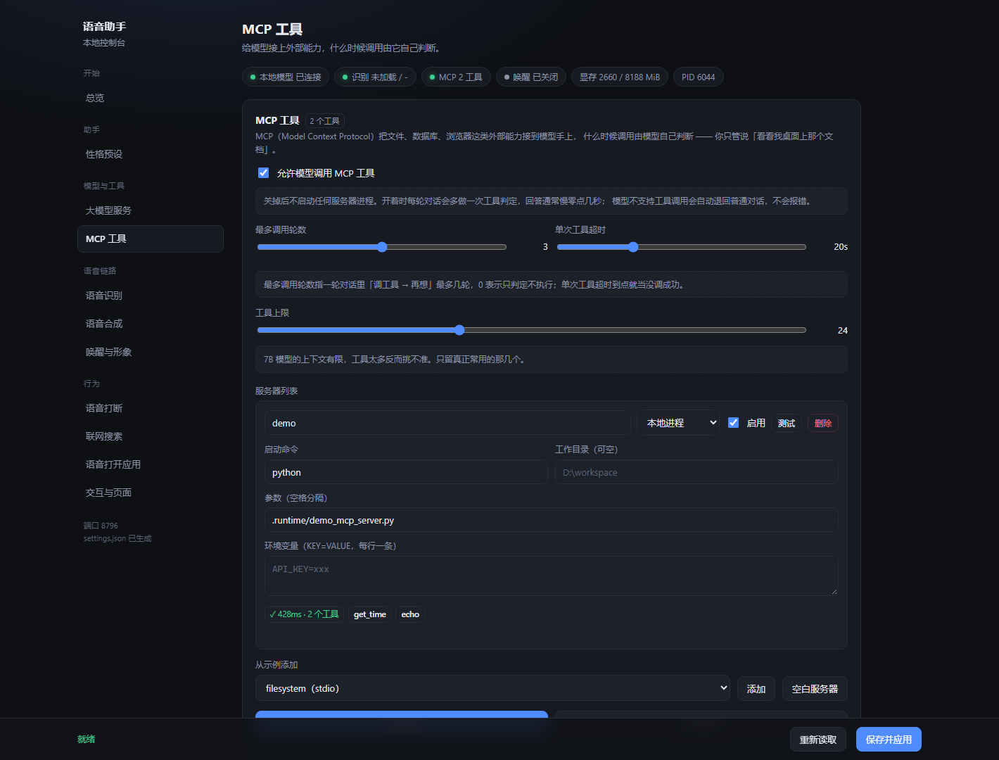
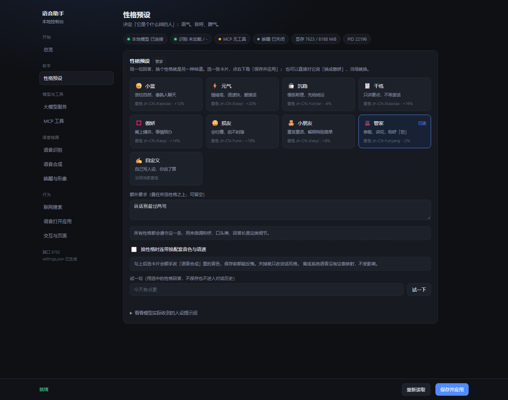
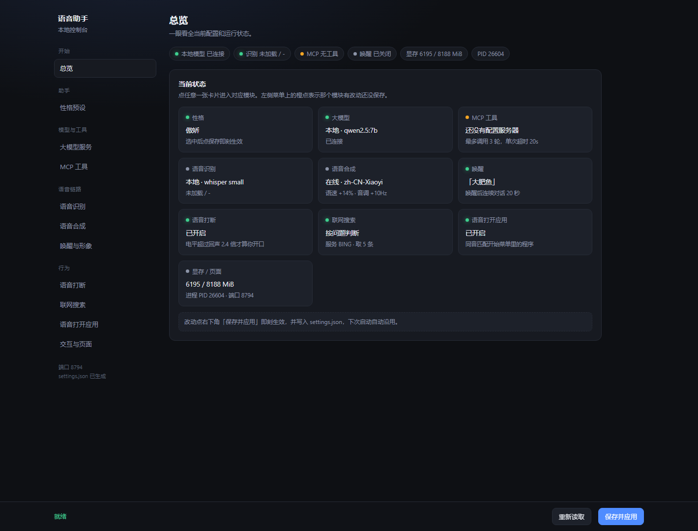

<div align="center">

# 🐋 小蓝 · 本地语音助手

**按住空格说话，松开不到一秒它就开始回答。**

一个跑在你自己电脑上的中文语音助手：识别、大模型、语音合成全程本地，
不听云端的，也不需要你把任何一句话交给别人。

`按住空格` · `喊「小蓝小蓝」` · `点桌面的她` —— 三种叫醒方式，同一条链路。


</div>

---

## 目录

- [先看一眼](#先看一眼)
- [能做什么](#能做什么)
- [快速开始](#快速开始)
- [怎么用](#怎么用)
- [它是怎么工作的](#它是怎么工作的)
- [识别得准不准](#识别得准不准)
- [唤醒词与连续对话](#唤醒词与连续对话)
- [语音打断](#语音打断)
- [联网搜索](#联网搜索)
- [语音打开本机应用](#语音打开本机应用)
- [MCP 工具](#mcp-工具)
- [性格预设](#性格预设)
- [配置页](#配置页)
- [实测性能](#实测性能)
- [配置项速查](#配置项速查)
- [一些设计取舍](#一些设计取舍)
- [常见问题](#常见问题)
- [安全与隐私](#安全与隐私)
- [目录结构](#目录结构)

---

## 先看一眼

一段典型的对话（示意，节奏按实测延迟标注）：

```
你：小蓝小蓝，今天有什么新闻
    （1.6 秒后）我来查一下。
    → 必应 RSS 拉回 5 条摘要
助手：最近几条里，比较受关注的是……整体是说……就这些，要我再细说哪一条吗？

你：不用了，打开记事本        ← 本机指令，不经过模型，瞬间响应
助手：已经打开了。

你：换个话题，讲讲为什么天是蓝色的
助手：它正要说……           ← 你中途插话，播报立刻停下接着听你说
```

延迟来自实际测量（`RTX 4060 8GB` + `qwen2.5:7b`）：松手到开口 **约 0.7 秒**，
其中模型首字 **0.07~0.19 秒**，识别只占 **0.2~0.5 秒**（3 秒的话约 0.16 倍实时）。
详见[实测性能](#实测性能)。

---

## 能做什么

| | |
|---|---|
| 🎙️ **三种叫醒方式** | 按住空格、喊唤醒词、点桌面上的形象，共用同一条链路 |
| 💬 **连续对话** | 唤醒一次后 20 秒内直接接着问，不用每句都喊名字；超时自动休眠 |
| 🖐️ **语音打断** | 它在念东西时你直接开口，播报立刻停。拿回声自己当基线，自己的声音不会打断自己 |
| 🔍 **联网搜索** | 问天气、新闻、股价时先去网上捞一段再照着说。**必应 RSS 免 Key**，不用注册任何东西 |
| 🚀 **语音打开应用** | 「打开微信」「启动计算器」，查表直接执行，不经过模型，也不消耗显卡 |
| 🛠️ **MCP 工具** | 接上 MCP 服务器后模型能自己动手：读文件、查日历、连数据库 |
| 🎭 **性格预设** | 八种腔调随时换，说一句「换成傲娇」就行；可选连带换音色和语速 |
| 🌐 **每个环节都能换服务** | 识别 / 模型 / 合成各有本地与网络两套，配置页里点一下切换，即时生效 |
| 🖥️ **桌面形象** | 独立进程，崩了不影响语音；右键菜单开配置页、退出，位置会记住 |
| 🔒 **默认就不联网** | 只有语音合成默认走 edge-tts，想完全离线切到系统语音即可 |

---

## 快速开始

### 环境要求

| 项目 | 要求 |
|---|---|
| 系统 | Windows 10 / 11（桌面形象、离线语音依赖 Windows） |
| Python | 3.11（3.10+ 基本可行） |
| 显卡 | 推荐 6GB 以上显存。没有独显也能跑，识别会从 0.16 秒变成约 1.5 秒 |
| 大模型 | [Ollama](https://ollama.com) + `qwen2.5:7b` |

### 三步跑起来

```bash
# 1. 装依赖
conda create -n voice-assistant python=3.11 -y
conda activate voice-assistant
pip install -r requirements.txt
pip install nvidia-cublas-cu12 nvidia-cudnn-cu12        # GPU 识别所需
pip install PySide6                                     # 桌面形象所需

# 2. 拉模型（约 4.7GB）
ollama pull qwen2.5:7b

# 3. 启动
python assistant.py
```

首次启动会下载识别模型（默认 `medium`，约 1.5GB，已默认走 `hf-mirror.com` 镜像），
并把 4.7G 的模型载入显存，**冷启动约 40 秒**。之后常驻，热态下可随时开口。
显存吃紧的话，配置页里把「识别模型」切成 `small`（约 500MB）或 `tiny` 即可。

看到控制台打印 `配置页 http://127.0.0.1:8765` 就准备好了。
对着麦克风 **按住空格** 说话，松开就开始回答。

> **不想看命令行**：双击 `start.vbs`，同时拉起助手和桌面形象，全程无窗口，
> 日志在 `.runtime/*.log`；要停就双击 `stop-all.bat`。

---

## 怎么用

| 双击 | 作用 |
|---|---|
| `start.vbs` | 启动助手 + 桌面形象，**不显示任何命令行窗口** |
| `run.bat` | 带控制台启动（想看日志、排查问题时用这个） |
| `config.bat` | 只开配置页，不占麦克风、不加载模型 |
| `stop-all.bat` | 关掉助手、桌面形象和 Ollama，释放全部显存 |

桌面形象的右键菜单里有 **打开配置页**、**开始说话**、**始终置顶**、**退出程序**；
左键点她 = 说一句话，按住拖动可以换位置（位置会记住）。

命令行用法：

```bash
python assistant.py              # 正常语音交互，同时开配置页
python assistant.py --config     # 只开配置页
python assistant.py --no-web     # 不启动配置页
python assistant.py --no-wake    # 不监听唤醒词，只留按住空格
python assistant.py --port 9000  # 换端口（默认 8765，占用时自动顺延）
python assistant.py --text "你好"          # 跳过录音，只测模型 + 播报
python assistant.py --text "打开记事本"    # 测本机指令（会真的启动）
python assistant.py --text "今天有什么新闻" # 测联网搜索
python assistant.py --no-audio   # 只打字不播报

python selftest.py               # 端到端自检（合成语音当输入，不需要麦克风）
python voices.py --demo          # 依次试听全部中文音色
python stop.py --dry             # 看看会被关掉哪些进程（不真关）
```

---

## 它是怎么工作的

```
按住空格 ─┐
说唤醒词 ─┼→ 录音 → 识别 → 大模型 → 逐句切分 → 语音合成 → 扬声器
点她的头 ─┘      0.2~0.5s  首字 0.1s   流式切句     0.05s/句
```

链路中间有三个岔路口，走的是更短的路：

- **「打开微信」查表直接执行**，不惊动大模型，反应是瞬间的；
- **问「今天新闻」先去网上查一段**，再把资料塞给模型照着说，省得它用训练数据里的旧世界一本正经地编；
- **接了 MCP 之后模型能自己调工具**，它决定调哪个、传什么参数。

每一环都有两套服务可选，在配置页里点一下就能换：

| 环节 | 本地 | 网络 |
|---|---|---|
| 识别 | faster-whisper `medium`（默认），GPU 约 0.2~0.5s | 任意 OpenAI 兼容 `/audio/transcriptions` |
| 大模型 | Ollama `qwen2.5:7b` | OpenAI 兼容接口（DeepSeek、硅基流动、百炼、智谱、Moonshot…） |
| 合成 | Windows SAPI，54ms/句，断网可用 | edge-tts，音质接近真人（默认） |

### 想完全离线？

默认组合「本地识别 + 本地模型 + 在线合成」里，只有语音合成需要联网。
把合成切到**离线系统语音**后，断网也能完整跑通，代价是声音偏机械 ——
但单句合成只要 54ms，比在线快了近 40 倍。

---

## 识别得准不准

默认就用当前的**最优搭配**（`识别模型 = auto`）。上一代方案（`small` + 没有下面两个开关）
在同样条件下错字明显更多，实测差异见下表。三件事决定了准确度：

**1. 模型重一档，收益最大。** `auto` 的含义是：有显卡就用 `medium`，只剩 CPU 就退回 `small`
（`medium` 在 CPU 上一句要算十几秒，语音场景根本等不了）。`medium` 会自动降精度为
`int8_float16`，比 `float16` 省一半显存，多出的空间留给大模型。

**2. 领域词提示。** 把本机程序名你常讲的词提前告诉 whisper，它会倾向于输出这些字。
实测 whisper 会把「打开记事本」听成「打开计识本」、「命令提示符」听成「命令提示服」 ——
加了提示之后这两类错误就没了。但**提示对 `medium` 反而有害**（它自己够强，再引导会被带偏，
同一批测试里有一处场景反而变差 4 个点），所以默认只在小模型上开，你可以在配置页手动改。

**3. 音量归一化。** 麦克风增益偏低、或者离得远的时候，整段音频峰值可能只有几百个量化单位，
whisper 内部的 mel 归一化救不回这么小的动态范围。开这项几乎不花时间，建议留着。

12 句日常指令合成后，在四种退化条件下的**字符错误率**（越低越好）：

| 条件 | 上一代 `small` | 现在的默认 `medium` |
|---|---|---|
| 干净录音 | 8.0% | **5.3%** |
| 远场（音量 ×0.05） | 8.0% | **5.3%** |
| 严重远场（音量 ×0.008） | 8.7% | **5.3%** |
| 强背景噪声（5dB） | 13.0% | **7.7%** |

代价是每句多约 130 毫秒 —— 考虑到听到的内容对了就不用再说第二遍，这笔账划算。

还想更准，按顺序试：

- 在配置页「语音识别」的**常用词**里写下你常讲的人名、产品名、地名（空格分隔）；
- 麦克风电平太低就去 Windows 声音设置把「麦克风级别」调大，配置页「唤醒」那里有实时峰值可以参考；
- `解码宽度` 调到 5 —— 实测在中文短句上**没有**准确率提升（只是慢三成），口音重或句子长时才值得一试。

---

## 唤醒词与连续对话

默认提示词「小蓝小蓝」，在配置页「唤醒与形象」里改，**保存即刻生效**。
提示词后面的内容会被当成这一次的指令 —— 「小蓝小蓝，今天天气怎么样」一句话说完即可，
不用先唤醒再重复一遍。

匹配按**读音**而不是字面：先转成不带声调的拼音再滑动窗口对齐，
所以识别成「小兰小兰」「小男小男」「晓岚晓岚」都能命中；易混的
`zh/z`、`ch/c`、`sh/s`、`n/l`、`ang/an`、`eng/en`、`ing/in` 也做了归一 ——
实测最常见的错误就是把「小蓝」听成「小男」，不归一基本唤不醒。
两个字的提示词要求读音全对，否则「小红」也能唤醒「小蓝」。

一次唤醒之后默认有 **20 秒**会话期：

```
休眠 ──说提示词──▶ 会话中：开口就说，答完接着等你下一句
  ▲                              │
  └──────── 20 秒没人说话 ────────┘
```

会话期里话筒是常开的，所以加了几道防自激的锁：

- 播报**真的放完**才开麦（`wait_done()` 从取到合成任务就开始算忙，不等声音出来）；
- 听到的内容和刚播报的高度重合就直接丢掉；
- 识别端开着 silero VAD 过滤 —— 不开这一项时，环境噪声会被 whisper 转成它训练集里的
  字幕套话，实测反复冒出「请不吝点赞 订阅 转发 打赏」，连续对话模式下就成了对着空气自说自话。

桌面形象的状态点会变暗（休眠）/ 变红（在听）/ 变绿（在说）；
配置页里有「验证提示词」输入框，不用对着麦克风反复试，
下面那行**监听状态**实时显示匹配方式、最近听到的内容、峰值电平和当前阈值，调参看这里最直观。

| 配置项 | 说明 |
|---|---|
| `WAKE_PHRASE` | 提示词，建议 3~6 个字、叠词（叠词比单词更不容易被日常聊天误触发） |
| `WAKE_SENSITIVITY` | 0~1，越大越容易判定为说话。嘈杂调低，小声说话调高 |
| `WAKE_SESSION_SECONDS` | 会话保持秒数，0 = 每句都要喊提示词 |

---

## 语音打断

它在念东西的时候你直接开口，播报立刻停，接着听你说下一句 —— 不用等它念完，也不用先喊名字。

难点是麦克风里混着它自己的播报声。这里不设固定阈值，而是拿**回声自己的峰值**当基线：
取最近 2 秒、但排除最近 0.45 秒（那段正是候选的人声）的最大电平，
要求当前电平超过它的若干倍，并且**持续**够久才算数。于是：

- 播报再响也是在跟自己的峰值比，不会自己打断自己；
- 人凑近说话时直达声通常比外放回声高好几倍，能稳定触发；
- 咳嗽、敲键盘这类短脉冲撑不满「持续时间」，会被挡掉。

打断后会把**打断前 1 秒**的音频接到新录的前面再识别，所以「停一下」这种在播报里说的半句不会丢；
万一接上的那截听着像它自己刚说的话，会自动退回只识别新录的部分。

配置页「语音打断」模块里有**实时电平条和触发线**（橙线），对着麦克风说话就能看到差多少：



| 配置项 | 说明 |
|---|---|
| `BARGE_IN_ENABLED` | 总开关 |
| `BARGE_IN_SENSITIVITY` | 0.1~1，越大越灵敏（要求超过回声的倍数从 3.7 倍降到 1.4 倍） |
| `BARGE_IN_MIN_MS` | 要持续多久才认定你在说话，默认 350ms；老被误打断就调大 |

---

## 联网搜索

问「今天天气怎么样」「英伟达现在股价多少」，本地模型的训练数据早过期了，它会一本正经地编。
开了联网，这类问题先去网上捞一段资料，再让模型**照着资料**说。

**什么时候查**（默认「按问题判断」，纯本地规则，零延迟）：

| 说法 | 判定 |
|---|---|
| 今天天气怎么样 / 最近有什么新闻 | 查 |
| 帮我查一下明天北京的天气 | 查（明确要求） |
| 英伟达现在股价多少 / 汇率是多少 | 查 |
| 现在几点 / 今天周几 / 今天几号 | 不查 —— 本地注入真实时间，直接答 |
| 你好 / 讲个笑话 / 今天有点累 | 不查 |

比的是**打分**而不是「命中任一关键词」：「今天」单独出现只值 3 分，够不到阈值 4，
所以「今天有点累」不会白跑一趟搜索。

**搜索服务**：默认必应，走 `cn.bing.com/search?format=rss` 的 RSS 输出 —— **免 Key、不用注册**、结构稳定
（不用解析网页 HTML，也不怕反爬改版），实测 300~400ms 返回。想要更好质量可以换：

| 服务 | 需要 | 说明 |
|---|---|---|
| 必应 | 无 | 默认。够用就别换 |
| Tavily | API Key | 专为喂大模型设计的摘要，质量最好 |
| 博查 | API Key | 国内服务，中文结果好 |
| SearXNG | 实例地址 | 自建才稳，公共实例大多连不上 |

资料是**临时**插进这一轮的，不写进对话历史 —— 否则下一轮它还会引用上个问题的旧网页。
搜索失败（超时、没 Key、网络不通）就当没查到，照常回答，不会卡住。

---

## 语音打开本机应用

说「打开微信」「启动计算器」「把画图打开」直接执行，不经过模型 —— 所以是**瞬间**的，也不消耗显卡。

应用名按**同音**匹配：「威信」「维信」「记是本」「计祘器」都认得。名字来自三个地方：

1. **内置表** —— 记事本、计算器、画图、任务管理器、设置这些系统自带的，不依赖安装位置；
2. **开始菜单** —— 扫 `.lnk`，一百多个文件只要 20 毫秒；
3. **商店应用** —— 前两级都找不到时才拉一次 `Get-StartApps`（结果缓存一周），「打开照片」这类 UWP 也能开。

**安全边界**：只在索引里查，查到才启动，查不到就当成普通聊天交回模型。所以：

- 不会执行任意命令，也不会打开索引之外的路径；
- 「开个玩笑」不会被当成启动指令（单个「开」字是弱意图，必须真查到应用才接管）；
- 「打开微信然后给张三发消息」这种复合指令不接 —— 否则就变成「只听懂一半就动手」。

配置页「语音打开应用」里可以先输入名字试一下，看它认不认得。

---

## MCP 工具

说「看看我项目的 README 写了什么」「今天日历上还有什么会」，本地模型做不了 —— 它得**真的去读文件**。
MCP（Model Context Protocol）就是给模型装手的协议：每个服务器对外暴露一组函数，
模型自己决定什么时候调用、传什么参数。

配置页「MCP 工具」里维护服务器清单，也可以直接改 `mcp.json` —— 格式和 Claude Desktop、
Cursor 那些客户端一致，别人的配置可以整段抄过来：



```json
{
  "mcpServers": {
    "filesystem": {
      "type": "stdio",
      "enabled": true,
      "command": "npx",
      "args": ["-y", "@modelcontextprotocol/server-filesystem", "D:\\workspace"]
    },
    "remote": {
      "type": "http",
      "enabled": false,
      "url": "http://127.0.0.1:8000/mcp",
      "headers": {"Authorization": "Bearer <token>"}
    }
  }
}
```

| `type` | 说明 | 典型写法 |
|---|---|---|
| `stdio` | 本地子进程，走 stdin/stdout 收发 JSON-RPC | `npx`、`uvx`、`python xxx.py` |
| `http` | 远程流式 HTTP（旧的 `sse` 已并入这一种） | `url` + 可选 `headers` |

```
你说话 → 模型看工具清单 → 决定调 filesystem__read_file
       → 本地执行 → 结果回填 → 组织成口语 → 播报
```

工具结果**临时**塞进这一轮，不写进对话历史 —— 否则上一轮的整篇网页会一直占着上下文，
下一句闲聊都会被带偏。

几条刻意的限制：

- **工具名带服务器前缀**（`filesystem__read_file`），避免两个服务器都有 `search` 时互相盖掉；
  中文服务器名会洗成下划线，因为模型只接受 `[A-Za-z0-9_-]`；
- **最多 `MCP_MAX_TOOLS` 个工具进提示词**：7B 模型工具一多就挑不准，宁可只留常用的；
- **最多 `MCP_MAX_ROUNDS` 轮**：防止「调工具→再想→再调」停不下来；
- **模型不支持工具调用会自动退回**：报错信息里带 tool/function 就当作不支持，按普通对话回答；
- **只执行配置里写死的命令**，语音指令永远只影响「调哪个工具、传什么参数」。

每个服务器都有「测试」按钮：真的把进程拉起来、握手、列工具，然后立刻关掉，
所以能在保存之前就确认命令写没写对。保存后是后台重连的，不用等。

---

## 性格预设

同一个模型，换一种腔调说话。内置八种，配置页里点一张卡片就换：



| 预设 | 味道 | 配套音色 |
|---|---|---|
| 小蓝（默认） | 亲切自然，像熟人聊天 | 晓晓 · +12% |
| 元气 | 情绪高、语速快、爱接话 | 晓伊 · +20% +15Hz |
| 沉稳 | 慢条斯理，先给结论 | 云健 · -6% -10Hz |
| 干练 | 只讲要点，不带废话 | 晓晓 · +16% -5Hz |
| 傲娇 | 嘴上嫌弃，事情照办 | 晓伊 · +14% +10Hz |
| 损友 | 会吐槽，但不刻薄 | 云希 · +18% +5Hz |
| 小朋友 | 童言童语，解释特别简单 | 晓伊 · +8% +45Hz |
| 管家 | 恭敬、讲究，称呼「您」 | 云扬 · -2% -12Hz |
| 自定义 | 自己写，你说了算 | 沿用当前音色 |

三点值得说明：

- **人设只管「是谁、什么脾气」，不管格式。** 口语化、短句、不许 Markdown 这些是「要被朗读」
  的硬约束，统一留在 `config.py` 的 `SYSTEM_PROMPT` 里。要是每个性格各抄一份，早晚有一个忘了
  禁止星号，扬声器就会把「**重点**」念成「星号星号重点星号星号」。
- **性格和音色可以分开。** 勾上「换性格时连带换配套音色」才动声音，不勾就只改说话风格。
- **说一句就换。** 「换成傲娇」「以后用管家的语气说话」「恢复正常语气」走本机指令通道，
  不绕模型 —— 所以新性格从**这一句应答**就开始生效，而不是先被旧性格回一句。
  疑问句（「换成傲娇会怎么样」）不会误触。

一个实测出来的细节：人设放开头时，7B 容易被后面那段强硬的格式规则压平 ——
同一句「今天好累」，傲娇会被答成标准客服腔。所以最终提示词会在末尾补一句
「格式只约束形式，口吻始终按某个风格」，加完之后三次采样都稳定带上了自己的尾巴。

---

## 配置页

启动后浏览器打开 `http://127.0.0.1:8765`（用 `start.vbs` 启动时不自动开，走形象的右键菜单）。
按功能分成十一个模块，左侧导航切换，右下角统一保存：



| 模块 | 能改什么 |
|---|---|
| 总览 | 十张状态卡片，点一下进对应模块；模块上带橙点表示有改动还没保存 |
| 性格预设 | 八种性格任选；额外要求、自定义人设；是否连带换音色；试答一句；查看最终提示词 |
| 大模型服务 | 本地 Ollama ↔ 网络接口；模型、温度、上下文、记忆轮数 |
| MCP 工具 | 服务器清单增删改、逐个测试、全部重连；调用轮数、超时、工具上限 |
| 语音识别 | 本地模型 ↔ 网络接口；GPU/CPU、模型大小、解码宽度 |
| 语音合成 | 在线 edge-tts ↔ 离线系统语音；音色、语速、音调，可当场试听 |
| 唤醒与形象 | 提示词、灵敏度、断句静音、连续对话时长；提示词自测、实时监听状态 |
| 语音打断 | 开关、灵敏度、持续时间；实时电平条与触发线 |
| 联网搜索 | 关闭 / 按问题判断 / 每次都查；后端、Key、结果条数、超时；试搜一句 |
| 语音打开应用 | 开关、试打开、本机认出多少个可打开的程序 |
| 显存 / 页面 | 最短/最长录音时长、配置页端口 |

切模块不会丢改动（表单一直在 DOM 里，只是隐藏），地址栏带 `#模块名`，
直接访问 `#mcp` 能停在那一页；`Alt+1`~`Alt+9`、`Alt+0` 是前十个模块的快捷键。

「保存并应用」之后：

- 大模型、语音合成、性格、唤醒的改动**立即生效**；
- 识别相关的改动会**自动重建识别模型**，页面回显切换后的设备（如 `cuda / float16`）；
- 改动同时写入 `settings.json`，下次启动自动沿用；
- 只有端口这类需要重新监听的项会提示「需重启」。

识别服务重建失败时（比如选了网络识别却没填 Key），**配置会自动回退**，
内存和 `settings.json` 一起还原，不会留下一个下次启动必然报错的状态。

---

## 实测性能

测试机 `RTX 4060 8GB` + `qwen2.5:7b`：

| 环节 | 耗时 |
|---|---|
| 语音识别 · `medium`（默认，3.3s 音频） | **527ms**，rtf 0.16 |
| 语音识别 · `small`（省显存，3.1s 音频） | 161ms，rtf 0.05 |
| 大模型首字 | **0.07 ~ 0.19s**（热态） |
| 大模型整段生成 | 0.39s（约 20 字回答） |
| **松手到开口** | **约 0.7 秒**（用 `small` 时约 0.6 秒） |
| 语音合成 · 离线 SAPI | **54ms / 句**（首次含 COM 初始化 240ms） |
| 语音合成 · 在线 edge-tts | 约 1.9s / 句（主要是网络往返） |
| 联网搜索（必应 RSS） | **300 ~ 410ms**，命中缓存则 0ms |
| 打开本机应用 | 不经过模型，耗时就在启动本身 |
| 首次冷启动 | 约 40s（两个模型载入显存，之后常驻） |

对照：whisper 跑 CPU 时同段音频要 1.5 秒以上，整体延迟翻三倍 —— 所以值得让它挤进 GPU。
7B Q4 占 4.7G，whisper `medium` 用 int8 精度约 1G（`small` 只要 500MB），两者在 8G 卡上能共存。

---

## 配置项速查

优先级：`settings.json`（配置页保存的） > `config.py`（默认值）。
`config.py` 写的是出厂默认，日常调整走配置页就行；想恢复默认，删掉 `settings.json` 重启即可。

| 项 | 说明 |
|---|---|
| `LLM_MODEL` | 换模型，如 `qwen2.5:3b`（更快） |
| `WHISPER_MODEL` | `auto`（推荐，有显卡用 medium、否则 small）/ `tiny` / `base` / `small` / `medium` |
| `ASR_NORMALIZE` | 识别前把音量拉到满刻度，远场和小声说话时能救回几个字 |
| `ASR_PROMPT_MODE` | 领域词提示：`auto`（小模型才用）/ `on` / `off` |
| `ASR_HOTWORDS` | 你常讲的专属词，空格分隔，会喂给识别模型当提示词 |
| `ASR_BEAM_SIZE` | 解码宽度，默认 1。实测中文短句上 5 并不比 1 准，只慢三成 |
| `TTS_VOICE` | 音色，内置 14 个中文音色，用 `python voices.py` 试听 |
| `TTS_RATE` / `TTS_PITCH` | 语速 / 音调，`+12%` 比默认更像真人对话 |
| `MAX_HISTORY_TURNS` | 记住几轮对话 |
| `WAKE_PHRASE` | 唤醒提示词，建议 3~6 个字、叠词 |
| `WAKE_SENSITIVITY` | 0~1，环境嘈杂时调低 |
| `WAKE_SESSION_SECONDS` | 会话保持秒数，0 = 每句都要喊提示词 |
| `BARGE_IN_ENABLED` | 是否允许说话打断播报 |
| `BARGE_IN_SENSITIVITY` | 打断灵敏度，0.1~1 |
| `BARGE_IN_MIN_MS` | 电平要持续多久才算「你在说话」 |
| `SEARCH_MODE` | `off` / `auto` / `always`，控制什么时候联网 |
| `SEARCH_BACKEND` | `bing` / `tavily` / `bocha` / `searx` |
| `SEARCH_KEY` | Tavily、博查的 Key；用必应时留空 |
| `SEARCH_RESULTS` | 取几条网页摘要喂给模型，多了反而跑题 |
| `APPS_ENABLED` | 允许说「打开某某」直接启动应用 |
| `MCP_ENABLED` | MCP 总开关；关掉后不启动任何服务器进程 |
| `MCP_CONFIG_FILE` | 服务器清单路径，默认 `mcp.json` |
| `MCP_MAX_ROUNDS` | 一轮里最多「调工具→再想」几轮，0 = 只判定不执行 |
| `MCP_TIMEOUT` | 单次工具调用超时（秒） |
| `MCP_MAX_TOOLS` | 最多几个工具进提示词；7B 别给太多 |
| `PERSONA_PRESET` | 性格 id：`default` / `lively` / `calm` / `pro` / `tsundere` / `sassy` / `kid` / `butler` / `custom` |
| `PERSONA_PROMPT` | 选 `custom` 时用的人设正文 |
| `PERSONA_EXTRA` | 叠在任何性格上的额外要求，如「别叫我主人」 |
| `PERSONA_VOICE` | 换性格时是否连带换音色语速 |
| `SYSTEM_PROMPT` | **只管格式**：口语化、短句、不许 Markdown。性格不写在这里 |

---

## 一些设计取舍

1. **显存预算先算清楚。** 7B Q4 占 4.7G，whisper `medium` 用 int8 精度约 1G，两者能共存；
   加载失败自动回退 CPU（回退时识别模型也跟着降到 `small`，不然 CPU 上慢到没法用），不会卡死。
2. **逐句播报。** 模型流式输出，遇到句末标点就切一句送去合成，播放线程串行消费，
   所以「边说边想」，不等全文生成完。
3. **能查表就别问模型。** 「打开微信」是查表题，交给模型既慢又危险。只有真的需要
   组织语言时才调模型，中间还会先判断要不要联网。
4. **时间戳放消息末尾。** 真实日期必须告诉模型，否则它拿训练数据里的日期回答「今天几号」。
   但不能塞在第一条 system 里 —— Ollama 按前缀复用 KV cache，每轮都变的前缀等于每轮都让缓存失效，
   首字延迟会从 0.1 秒涨到 0.5 秒以上。
5. **配置是活对象。** `config` 模块就是唯一真相，业务模块每次调用都重新读它，
   所以网页改完即刻生效；`settings_store` 只负责校验和落盘。
6. **桌面形象独立成进程。** Qt 事件循环和语音主循环互不干扰，两者只用本机 HTTP 说话。
   界面卡住不会拖慢识别，语音卡住也能照常拖动窗口。

---

## 常见问题

**双击 `run.bat` 报「'1' 不是内部或外部命令」**
批处理被存成了 LF 换行。cmd.exe 只认 CRLF，换行不对会把多行命令拼成一团。
修复：`python tools/normalize_eol.py`（把 `.bat` / `.vbs` 统一成 CRLF + 纯 ASCII）。
`.gitattributes` 已强制 `*.bat` 使用 CRLF。

**首次运行卡在「加载识别模型」**
默认要下载 `medium`（约 1.5GB）。代码已默认走 `HF_ENDPOINT=https://hf-mirror.com` 镜像；
若仍失败，可以去 [HF 镜像站](https://hf-mirror.com) 手动下载后放到 `models/faster-whisper-medium/`
（里面要有 `model.bin`）。显存紧张的话改成 `small` 或 `tiny`，体积分别降到 500MB / 75MB。

**提示「GPU 不可用，回退 CPU」**
CUDA 运行库没找到，`pip install nvidia-cublas-cu12 nvidia-cudnn-cu12` 后重启即可。
回退后功能完整，只是识别从 0.16 秒变成 1.5 秒。

**按空格没反应**
pynput 监听全局键盘。若以管理员权限运行了别的窗口，需要同样以管理员身份运行本程序。

**说了唤醒词没反应**
先去配置页「验证提示词」里输入试试：认得出说明文字匹配没问题，问题在麦克风侧。
看下面那行**监听状态**：峰值一直低于门槛就调高**灵敏度**；压根没有峰值跳动就是没听到声音。
另外播报期间唤醒是关掉的（防自激），等它说完再说。

**觉得它听不懂你**
先看配置页「唤醒」那行的实时峰值：说话时都不到 0.01，说明是麦克风电平太低，
去 Windows 声音设置把「麦克风级别」调大。电平正常但仍然听错，就去「语音识别」
把你常讲的人名、产品名写进**常用词**；远场或环境吵的话，把 **领域词提示** 改成
「一直开着」再试一次。详见[识别得准不准](#识别得准不准)。

**「最近听到」是一堆莫名其妙的话**
whisper 在近乎静音的音频上会凭空编句子（典型是「请不吝点赞 订阅 转发 打赏」）。
代码有能量门槛 + silero VAD 两道过滤挡掉大部分。这不影响正确性（编出来的话不会命中提示词），
把灵敏度调低可以进一步减少。

**它对着空气一直自问自答**
会话模式下出现过，现在有播报放完才开麦、内容重合就丢掉、识别端 VAD 三道锁。
如果还复现，先看是不是外接音箱离麦克风太近 —— 把「连续对话」调到 0 能立刻止损。

**问「今天天气」没联网，还是乱编**
去配置页「联网搜索」点「搜一下」：状态行会告诉你后端通不通、
以及这句话在自动模式下判不判要搜（附打分理由）。判「不查」就说明没凑够分，
嫌保守就把「什么时候查」改成「每次都查」。

**说「打开某某」没反应，它却开始聊天**
说明名字没匹配上 —— 代码有意「找不到就不接管」，免得瞎开东西。
去配置页输入同样的名字点「打开」，命中就会回显匹配到的是哪个程序。
应用清单是启动时扫的，刚装新软件重启一下助手。

**桌面形象不出现**
看 `.runtime/pet.log`。常见原因是缺 PySide6（`pip install PySide6`）或缺 `assets/pet.png`
（跑一次 `python pet_asset.py`）。显示「没有连接到助手进程」说明助手还没起好。

**回答读出来很生硬 / 带符号**
调 `SYSTEM_PROMPT` 更严厉地禁止 Markdown；`tts.sanitize()` 也会兜底清理。

**想完全离线**
配置页把「语音合成服务」切到**离线系统语音**即可，识别和大模型本就在本地。

**配置页打不开 / 端口冲突**
端口占用时会自动顺延到下一个，以控制台打印的地址为准。若端口全被占会提示启动失败，
但语音功能不受影响。

**终端里连不上 127.0.0.1:11434，Ollama 却开着**
`HTTP_PROXY` 没配 `NO_PROXY`，本地请求被送去代理了。代码已对 `127.0.0.1` 自动绕开代理，
命令行手动调接口时记得 `curl --noproxy '*'`。

---

## 安全与隐私

- **默认本地闭环**：识别、大模型、语音合成全在本机，唯一的外发内容是联网搜索的查询词
  （可一键关掉）和 edge-tts 的文本（切离线即完全不外发）。
- **配置页只监听 `127.0.0.1`**，写操作还要求一个自定义请求头，别的网页改不了你的配置；
  API Key 保存后只显示末四位。
- **语音不能触发任意命令**：打开应用只在索引里查表，MCP 只执行 `mcp.json` 里写死的命令，
  语音只能决定「调哪个工具、传什么参数」。
- `settings.json`、`mcp.json` 已加进 `.gitignore`，仓库只留 `mcp.example.json` 模板；
  `.githooks/pre-commit` 会在提交前扫一遍密钥，配合 `tools/check_secrets.py` 双重拦截。

---

## 目录结构

```
start.vbs         双击启动（助手 + 桌面形象，无窗口）
stop-all.bat      双击全关（助手 + 形象 + Ollama）
run.bat           带控制台启动（调试用）
config.bat        只开配置页
config.py         默认配置（会被 settings.json 覆盖）
settings_store.py 配置校验、持久化、热更新
webserver.py      Web 配置服务（标准库，只监听本机）
webui/index.html  配置页单文件前端
audio_io.py       录音流 + 音频播放
asr.py            本地 faster-whisper / 网络识别，自动回退 CPU
llm.py            Ollama / OpenAI 兼容接口，统一流式输出 + MCP 工具循环
tts.py            切句器 + 双引擎合成 + 播放队列
vad.py            能量断句（自适应噪声底）
wake.py           唤醒词检测 + 同音（拼音）匹配
bargein.py        语音打断：回声基线之上的持续人声检测
search.py         联网搜索（必应 RSS 免 Key）+ 何时该搜的判断
apps.py           打开本机应用：内置表 + 开始菜单 + 商店应用，同音匹配
mcp_tools.py      MCP 客户端：stdio / http 两种传输、工具注册表、后台重连
persona.py        性格预设：人设文案、配套音色、口语化切换指令
pet.py            桌面悬浮形象（PySide6，独立进程）
pet_asset.py      形象抠图：原图 → assets/pet.png
assistant.py      主循环、语音链路、识别热重载
selftest.py       端到端自检
voices.py         音色列表与试听
stop.py           一键关闭（stop.bat / stop-all.bat 背后的实现）
tools/            换行符规整、提交前敏感信息扫描
.githooks/        pre-commit 钩子（挡住密钥被提交）
docs/images/      README 里的截图
assets/pet.png    抠好透明通道的形象（pet_src.jpg 是原图）
settings.json     配置页生成的本地配置（不入库）
mcp.json          MCP 服务器清单（可能含 token，不入库）
```

`mcp.example.json` 是可以直接抄的服务器模板。

---

## 待办方向

- [ ] Linux / macOS 支持（离线语音与桌面形象目前依赖 Windows）
- [ ] 用更小的模型做意图分类，进一步压缩延迟
- [ ] 会话记忆持久化（跨重启）
- [ ] 更多性格预设与自定义音色映射
